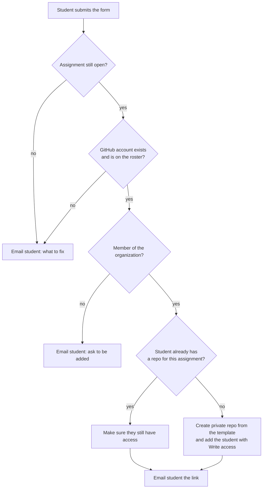

# Assignment Repos from a Google Form

A Google Apps Script that replaces GitHub Classroom's assignment invitation links with a Google Form. A student enters their GitHub username and picks an assignment. The script creates a private repository for them in your GitHub organization from that assignment's template repository, gives them Write access, and emails them the link.

There's no assignment list to maintain. Any template repository in your organization shows up in the form automatically, and unticking it closes the assignment.

## How it works

### Assignments come from GitHub

Every repository in your organization that has **Template repository** ticked in its settings, and isn't archived, is an open assignment.

| | |
|---|---|
| **Label in the form's dropdown** | The template repo's description, or its name if it has no description |
| **Student repository name** | `<template repo name>-<GitHub username>`, for example `hw01-landing-page-octocat` |
| **Order in the dropdown** | By repo name, with numbers in natural order (`hw2` comes before `hw10`) |
| **Closing an assignment** | Untick **Template repository**, or archive the template repo. Repos students already have are not affected. |

The dropdown is rebuilt from GitHub every 15 minutes (configurable), or right away from the form editor: click the puzzle-piece icon in the top toolbar, then **Repo tools → Refresh assignments**.

### What happens when a student submits

If something unexpected goes wrong at any step (an expired token, a missing permission, a GitHub outage), you get an email with the full error and the student gets a short note saying you've been told.

Submitting again is safe. A student who already has a repository for an assignment gets the same link again instead of a second repository, and if they've lost access to it, their access is restored.

## What you need

- A GitHub organization that you're an owner of. A free organization works.
- A Google account to own the form and the script, either personal or Google Workspace. The script runs as this account, and student emails are sent from it.
- Students with GitHub accounts.

## Setup

Allow about 30 minutes, and do the steps in order. The testing step depends on everything before it.

### 1. Prepare the GitHub organization

1. In the organization, open **Settings → Member privileges**.
2. Set **Base permissions** to **No permission**. **This is what keeps student repositories private from each other.** With any other setting, every member of the organization can open every student's repository.
3. Optional, on the same page: under **Repository creation**, untick Public and Private so students can't create their own repositories in the organization.
4. Invite your students under **People → Invite member**. They have to accept the invitation before the form will make them a repository, unless you turn off `REQUIRE_ORG_MEMBERSHIP` (see [Configuration](#configuration)).

Teaching staff who need to see every student's repository should be organization owners, or hold an organization-wide read role if your GitHub plan offers one. The script adds only the student to each repository.

### 2. Create a template repository for each assignment

1. Create a repository in the organization containing the starter code. It can be private; students never need access to the template itself.
2. In the repository's **Settings → General**, tick **Template repository**.
3. Set the repository's **description** (the gear icon next to **About** on its main page) to the text students should see in the dropdown, for example `Homework 1: Landing page`.

Tips:

- Name templates so they sort the way you want, for example `hw01-...`, `hw02-...`.
- Keep names short. The student repository name adds a hyphen and the username, and GitHub caps repository names at 100 characters.
- Student repositories get the template's default branch only, starting from a single commit (none of the template's commit history).

### 3. Create a GitHub access token

The script talks to GitHub with a fine-grained personal access token. Create it from the account of an organization owner.

1. On GitHub, open **Settings → Developer settings → Personal access tokens → Fine-grained tokens → Generate new token**.
2. **Resource owner**: your organization. If it isn't listed, an owner needs to allow fine-grained tokens in the organization's **Settings → Personal access tokens**.
3. **Expiration**: a date after your term ends. When the token expires, provisioning stops until you add a new one.
4. **Repository access**: **All repositories**. "Only select repositories" won't work, because the token has to reach repositories the script creates later.
5. **Permissions**:

   | Section | Permission | Access | Used for |
   |---|---|---|---|
   | Repository | Administration | Read and write | Creating repositories and adding the student |
   | Repository | Contents | Read-only | Copying the template |
   | Repository | Metadata | Read-only | Added automatically |
   | Organization | Members | Read-only | Checking that a student is in the organization |

6. Generate the token and copy it. If your organization requires approval for tokens, approve it under the organization's **Settings → Personal access tokens → Pending requests**.

A classic token with the `repo` and `read:org` scopes also works, if your organization allows classic tokens.

### 4. Create the Google Form

1. Create a new Google Form.
2. In **Settings → Responses**, turn on **Collect email addresses**. Choose **Verified** so students sign in with Google and the address is guaranteed to be theirs. Without email collection, students receive no emails at all.
3. Leave **Limit to 1 response** off. Students submit the form once per assignment.
4. Add a **Short answer** question titled exactly `GitHub username`, and make it required.
5. Either add a **Dropdown** question titled exactly `Select Your Assignment`, or let the script add it for you in step 7. Don't type choices into it; the script overwrites them.

You can use different question titles as long as you set the same titles in `CONFIG`.

### 5. Add the script to the form

1. In the form editor, open the **⋮** menu and choose **Apps Script**. This opens a script project attached to the form.
2. Replace everything in `Code.gs` with the contents of [`Code.gs`](Code.gs) from this repository.
3. Edit the `CONFIG` block at the top. At a minimum, set `ORG`, `ORG_DISPLAY_NAME`, `INSTRUCTOR_EMAIL`, `CONTACT_NAME` and `EMAIL_SUBJECT_PREFIX`. Every setting is described under [Configuration](#configuration).
4. Save (Ctrl+S or ⌘S).

### 6. Store the token

1. In the Apps Script editor, click **Project Settings** (the gear icon in the left sidebar).
2. Under **Script Properties**, add a property named `GITHUB_TOKEN` with your token as its value, and save.

Keep the token out of `Code.gs`, especially if you commit your copy anywhere.

### 7. Test

In the Apps Script editor, pick a function from the dropdown in the toolbar and click **Run**. Output appears in the execution log below the code.

1. **`testSetup`**. The first run asks you to authorize the script. Google shows a "Google hasn't verified this app" screen because this is your own unpublished script; choose **Advanced → Go to *(project name)***. The log should show `Org access: HTTP 200`, `Member check: HTTP 200 (OK)`, and one line per open template with an example student repository name.
2. **`syncAssignmentDropdown`**. Fills in the form's assignment dropdown, adding the question at the end of the form if it doesn't exist yet. Check it in the form.
3. Optional: **`testEmail`**, **`testProblemEmail`** and **`testNotMemberEmail`** send sample emails to `INSTRUCTOR_EMAIL` so you can check the wording and header image.
4. Optional: **`testProvision`** creates a real repository without going through the form. First replace `YOUR-TEST-GITHUB-USERNAME` inside the function with a test account that is in your organization, and delete the repository afterwards.

When authorizing, the script asks to manage your forms, connect to an external service (GitHub), send email as you, run when you aren't present (for the triggers), and access Google Drive. Drive access is used only to read the email header image when you set `HEADER_IMAGE_DRIVE_FILE_ID`; Apps Script requests it either way because the code refers to Drive.

### 8. Go live

1. Run **`installTrigger`**. It installs two triggers, one for form submissions and one on a timer that refreshes the dropdown, then refreshes the dropdown once. Running it again is safe; it replaces the earlier triggers.
2. Reload the form editor and check the refresh menu. Click the puzzle-piece icon in the top toolbar (next to the palette and preview icons) and choose **Repo tools**. A window titled with your Apps Script project's name opens; click **Refresh assignments** in it. It rebuilds the dropdown from GitHub and then shows a message saying either "Assignments updated" or "Already up to date", with the list of open assignments. After an update, reload the form preview to see the new choices.

3. Submit the form yourself from the preview (the eye icon) and check that the repository and the email arrive.
4. Share the form's link with students.

The triggers run as you. Emails come from your Google account, and provisioning stops if your account loses access to the form or you revoke the script's authorization.

## Running a term

| To... | Do this |
|---|---|
| Open a new assignment | Create a template repository (step 2). It appears in the form within 15 minutes, or immediately via the puzzle-piece icon → **Repo tools → Refresh assignments**. |
| Close an assignment | Untick **Template repository** or archive the template. Students who already have a repository keep it. |
| Rename an assignment in the form | Edit the template repository's description, then refresh. |
| Keep a template out of the form | Add its repository name to `EXCLUDE_TEMPLATES`. |
| Find every student's repository for an assignment | In the organization's **Repositories** tab, search for the template's name. |
| Send a student their link again | Have them resubmit the form. |
| Keep a record of who submitted what | Link the form to a Google Sheet (**Responses → Link to Sheets**). Each row has the student's email, GitHub username and assignment. |
| Start a new term | Make a copy of the form (the script is copied with it). Update `CONFIG`, set `GITHUB_TOKEN` (with a new token if you use a new organization), and run `installTrigger()` in the copy. Triggers are not copied. |

A student who changes their GitHub username gets a new repository on their next submission, because the repository name includes the username.

## What students do

1. Accept the invitation to join the GitHub organization.
2. Fill in the form: their GitHub username (a profile link or `@username` also works) and the assignment.
3. Open the link in the email they receive. If you've turned off `REQUIRE_ORG_MEMBERSHIP` and they aren't in the organization, the email also links to a repository invitation they need to accept first.

## Emails

| Situation | Sent to | Subject |
|---|---|---|
| Repository created | Student | `<prefix> Your repo for <assignment>` |
| Student already had a repository | Student | Same subject; the email says no new repository was created |
| Student isn't in the organization | Student | `<prefix> Your repo for <assignment> could not be created` |
| A problem the student can fix: invalid or nonexistent username, not on the roster, assignment closed, no assignments open | Student | `<prefix> Problem creating your repo for <assignment>` |
| Anything else: token, permissions, GitHub errors, form misconfiguration | You get the full error (`Repo provisioning failed`); the student gets a short "something went wrong" note | |

To change the wording, edit `notifyStudent()`, `notifyNotMember()`, `notifyProblem()` and `notifyFailure()` in `Code.gs`. Each sends a plain-text version and an HTML version.

## Configuration

All settings are in the `CONFIG` block at the top of `Code.gs`.

| Setting | Default | What it does |
|---|---|---|
| `ORG` | `'your-org-name'` | Your organization's login, the part after `github.com/`. |
| `ORG_DISPLAY_NAME` | `'Your Course'` | How the organization is named in the "not a member yet" email. |
| `PERMISSION` | `'push'` | Access each student gets on their repository: `'pull'` (Read), `'triage'`, `'push'` (Write), `'maintain'` or `'admin'`. Write lets students push but not change visibility, delete the repository or add people. |
| `REQUIRE_ORG_MEMBERSHIP` | `true` | `true`: only org members get a repository. `false`: anyone with a GitHub account does; non-members are added as outside collaborators and must accept an invitation. |
| `ALLOWED_USERNAMES` | `[]` | Optional roster of GitHub usernames (not case sensitive). Empty allows anyone who can submit the form. Typically left empty if `REQUIRE_ORG_MEMBERSHIP` is `true` |
| `EXCLUDE_TEMPLATES` | `[]` | Template repository names to leave out of the dropdown. |
| `USERNAME_QUESTION` | `'GitHub username'` | Title of the username question. |
| `ASSIGNMENT_QUESTION` | `'Select Your Assignment'` | Title of the assignment dropdown. The dropdown sync needs an exact match; if it finds none, it adds a new question. |
| `SYNC_INTERVAL_MINUTES` | `15` | How often the dropdown refreshes: 5, 10, 15, 30 or a multiple of 60. Run `installTrigger()` again after changing it. |
| `NO_ASSIGNMENTS_LABEL` | `'No assignments are open right now'` | The only dropdown choice when nothing is open. |
| `INSTRUCTOR_EMAIL` | `'instructor@example.edu'` | Receives error reports and the sample emails from the test functions. |
| `CONTACT_NAME` | `'your instructor'` | Who students are told to contact, shown as "Name (email)". |
| `CONTACT_EMAIL` | `''` | Contact address shown to students. Empty uses `INSTRUCTOR_EMAIL`. |
| `EMAIL_SUBJECT_PREFIX` | `'[Course]'` | Added to the start of every student email subject. Can be empty. |
| `HEADER_IMAGE_URL` | `''` | Optional public `https` link to an image shown at the top of student emails. |
| `HEADER_IMAGE_DRIVE_FILE_ID` | `''` | Optional instead of the URL: the ID of an image in your Google Drive (from `drive.google.com/file/d/<ID>/view`). |
| `HEADER_IMAGE_ALT` | `''` | Alt text for the header image. |

The script also keeps three values in **Script Properties**: `GITHUB_TOKEN` (you set it), and `FORM_ID` and `ASSIGNMENT_MAP` (the script maintains them; leave them alone).

## Troubleshooting

Start in the Apps Script editor. **Executions** in the left sidebar lists every run with its log and any error, and **Triggers** (the clock icon) shows the installed triggers.

| Symptom | Likely cause and fix |
|---|---|
| `testSetup` shows `Org access: HTTP 401` | The token is wrong or expired. Copy it into `GITHUB_TOKEN` again, or create a new one. |
| `testSetup` shows `Org access: HTTP 404` | `ORG` is misspelled, or the token's resource owner isn't this organization. |
| `Member check` isn't `HTTP 200` | The token is missing **Organization → Members: Read-only**. |
| `Create repo from template failed (HTTP 403)`, "Resource not accessible by personal access token" | The token is missing **Administration: Read and write**, its repository access isn't **All repositories**, or it's still waiting for organization approval. |
| `Add collaborator failed (HTTP 404)` right after a repository was created | The token's repository access is "Only select repositories", so it can't see the new repository. Switch to **All repositories**. |
| Students are told an open assignment "is no longer accepting new repositories" | The template isn't ticked or is archived, or the token can't see it (GitHub reports that the same way as a missing repository). Run `testSetup`. |
| You get "Could not find the assignment answer in this submission" | The question titles don't match `CONFIG`. The email lists every title that was received. |
| The dropdown doesn't update | Check that the template is ticked and not archived, then use the puzzle-piece icon → **Repo tools → Refresh assignments** and reload the form. Check **Triggers** for `syncAssignmentDropdown` and **Executions** for errors. |
| A second assignment dropdown appeared at the end of the form | The original question's title didn't exactly match `ASSIGNMENT_QUESTION`. Delete one, and make the remaining title match. |
| "... exists but is not a dropdown" | The assignment question is another type, such as multiple choice. Change it to **Dropdown** or delete it. |
| **Repo tools** is missing under the puzzle-piece icon | Reload the form editor after saving the script. It only appears for people who can edit the form. |
| **Refresh assignments** shows "Could not refresh assignments" | The message includes the error. The usual causes are the same token problems as in the rows above; run `testSetup` for details. |
| Students don't get emails | Make sure the form collects email addresses, have them check spam, and check **Executions** for errors such as the daily email quota (see [Limits](#limits)). |
| A submission produced no email at all | Look in **Executions**. A submission that waits more than 30 seconds for an earlier one fails with a lock error that only shows there; the student can resubmit. |
| `Repo name ... is longer than GitHub's 100-character limit` | Shorten the template repository's name. |
| `SyntaxError` mentioning `class` or `const` | The project is on the old Rhino runtime. In **Project Settings**, tick **Enable Chrome V8 runtime**. |

## Limits

- **Email**: Apps Script can send email to about 100 recipients a day from a personal Google account and about 1,500 from Google Workspace ([current quotas](https://developers.google.com/apps-script/guides/services/quotas)). Each submission sends one email. For a large class, use a Workspace account.
- **Trigger runtime**: personal accounts also have a daily cap on total trigger runtime. Each dropdown refresh takes a few seconds, so this rarely matters; if it does, raise `SYNC_INTERVAL_MINUTES`.
- **GitHub API**: 5,000 requests an hour per token. A submission uses a handful, and a dropdown refresh uses one per 100 repositories in the organization.
- **Repository count**: assignment discovery reads the first 2,000 repositories in the organization.
- **One submission at a time**: submissions are processed in order under a lock, so a burst of submissions queues up for a few seconds each.

## Security notes

- The token can administer every repository in the organization. Anyone with edit access to the form can open the script and read its Script Properties, so only give form edit access to people you'd trust with the token.
- Give the token an expiration date and revoke it when the term ends.
- Student repositories are private, and Write access doesn't let students change visibility, delete the repository or add people. Privacy between students also depends on the organization's base permission being **No permission** (setup step 1).
- Error details, which can include GitHub API responses, go only to `INSTRUCTOR_EMAIL`. Students see plain-language messages.

## Function reference

Run these from the Apps Script editor.

| Function | What it does |
|---|---|
| `testSetup()` | Checks the token and lists the open assignments, with an example student repository name for each. Run it first, and again after changing the token. |
| `syncAssignmentDropdown()` | Rebuilds the assignment dropdown from GitHub now. |
| `installTrigger()` | Installs the form-submit and timer triggers and refreshes the dropdown. Run once; safe to run again. |
| `testEmail()`, `testProblemEmail()`, `testNotMemberEmail()` | Send sample emails to `INSTRUCTOR_EMAIL`. |
| `testProvision()` | Creates a real repository for a test account without the form. |

These run on their own:

| Function | When it runs |
|---|---|
| `onFormSubmitHandler(e)` | On every form submission. |
| `syncAssignmentDropdown()` | On the timer set by `SYNC_INTERVAL_MINUTES`. |
| `onOpen()` | When an editor opens the form; adds **Repo tools** under the puzzle-piece icon. |
| `refreshAssignmentsFromMenu()` | When you click **Refresh assignments**; runs `syncAssignmentDropdown()` and shows the result. |
